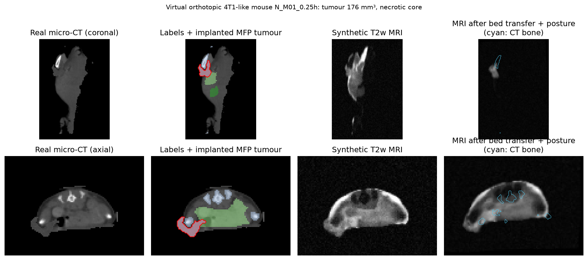
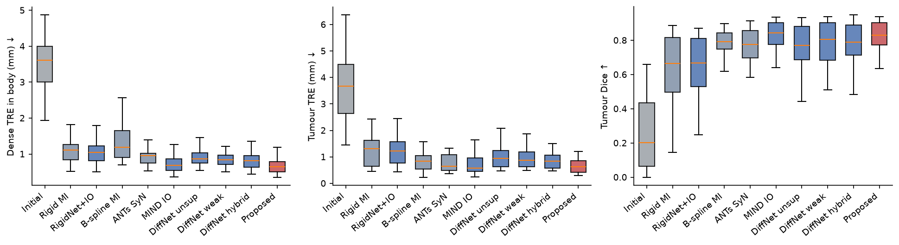
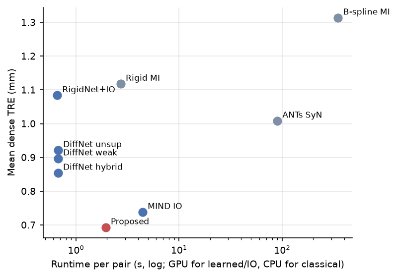
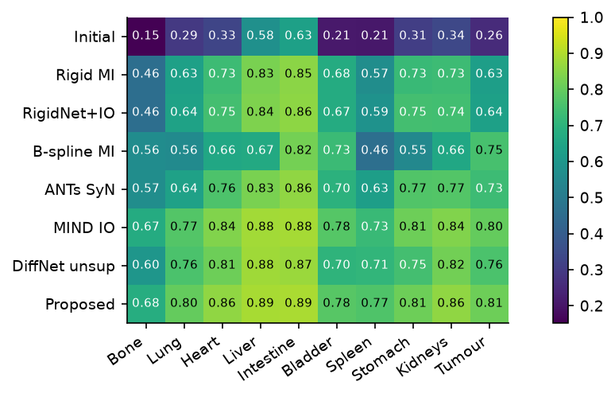
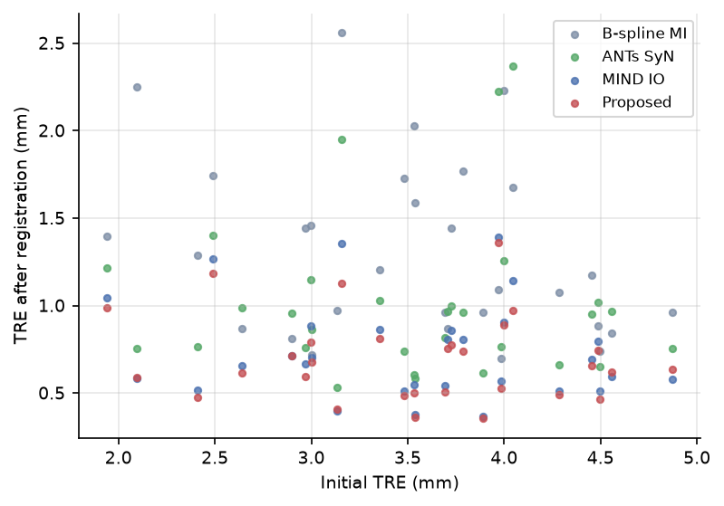
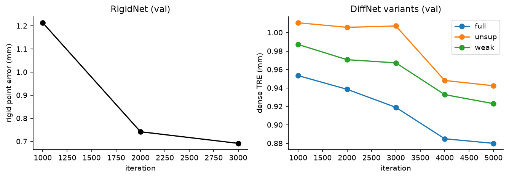
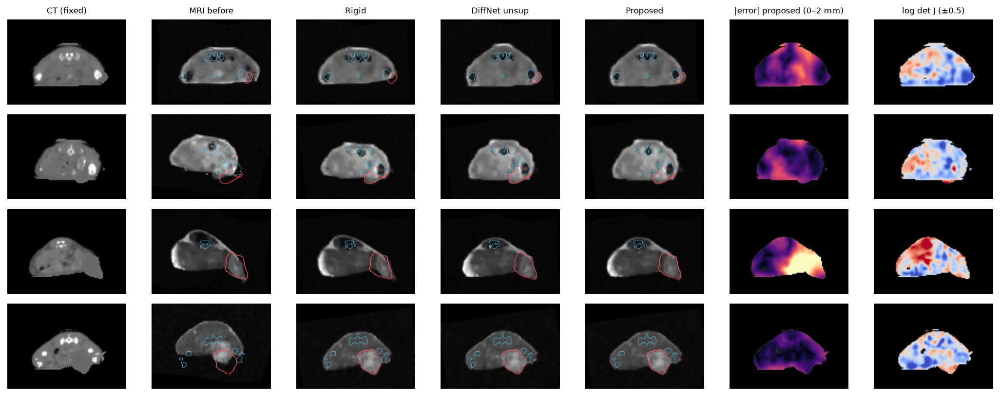

# MouseReg-AI: Multimodal 3D MRI ↔ CT Registration for Orthotopic Breast-Cancer Mouse Models

**Project 11 · Husain Naqvi · 2026** · preclinical cancer imaging · [findings write-up](docs/FINDINGS.md) · [figure gallery](https://engr-husainnaqvi.github.io/MouseReg-AI/)

Orthotopic breast-cancer mice are imaged with **T2w MRI** (tumour, necrosis, soft tissue) and **micro-CT** (bone, lungs, attenuation). Fusing the two scans is hard for three reasons:
- the animal is moved between scanners on a transfer bed, which shifts and rotates it;
- the soft abdomen and the mammary fat pad deform with posture;
- the two modalities share no intensity relationship.

This project asks **which registration algorithm maps MRI onto CT most accurately at the tumour, fast enough to use during a scan session, without tearing or folding tissue**. It compares 5 candidate approaches and 5 hybrid methods.

No public paired mouse MRI–CT dataset with orthotopic tumours exists, so I built a **virtual cohort on real anatomy**:
- **221 real whole-body micro-CT scans of 30 mice** (Rosenhain et al., *Sci. Data* 2018), each with an implanted orthotopic **mammary-fat-pad tumour**;
- a **physics-inspired synthetic T2w MRI** for every scan;
- an **exactly known diffeomorphic misalignment**, so the true position of every voxel is known.

The methods are evaluated on **58 frozen test pairs from 4 held-out mice**.

## Headline result

The proposed pipeline has three stages:
1. a learned rigid stage (RigidNet + MIND-SSC refinement);
2. an anatomy-aware diffeomorphic network trained on simulated pairs with MIND-SSC + organ/tumour Dice + synthetic ground-truth flow;
3. 50 iterations of MIND-SSC instance optimisation.

Over all 58 test pairs it registers a mouse in **2 s with 0.69 mm dense error and 0.81 mm tumour error** (tumour Dice 0.794), with **zero folding**. That is more accurate than ANTs SyN, B-spline FFD and rigid MI, and 40–190× faster than the two classical deformable methods.

| Method (30 paired test pairs) | Dense TRE (mm) | Tumour TRE (mm) | Tumour Dice | Organ Dice | Folding % | Time / pair |
|---|---|---|---|---|---|---|
| Initial misalignment | 3.52 | 3.68 | 0.257 | 0.342 | – | – |
| Rigid MI (SimpleITK) | 1.12 | 1.26 | 0.629 | 0.696 | 0 | 2.8 s CPU |
| Rigid + B-spline FFD, MI (SimpleITK) | 1.31 | 0.85 | 0.752 | 0.652 | **1.43** | 390 s CPU |
| ANTs SyNRA (MI) | 1.01 | 1.01 | 0.733 | 0.732 | 0 | 88 s CPU |
| DiffNet unsupervised (VoxelMorph-style) | 0.92 | 1.02 | 0.759 | 0.778 | 0 | 0.8 s GPU |
| MIND-SSC instance optimisation only (ConvexAdam-style) | 0.74 | 0.75 | 0.800 | 0.807 | 0 | 4.6 s GPU |
| **Proposed: anatomy-aware DiffNet + IO** | **0.69** | **0.72** | **0.814** | **0.823** | **0** | **2.1 s GPU** |

*The table uses the 30 pairs on which every method, including the slow classical baselines, was run. On all 58 test pairs the proposed method scores 0.69 mm dense TRE, 0.81 mm tumour TRE and 0.794 tumour Dice; see [FINDINGS](docs/FINDINGS.md).*

- **Significant against every baseline.** Paired Wilcoxon tests on 29 scans versus ANTs SyN: dense TRE −0.32 mm (p = 4e-9), tumour TRE −0.31 mm (p = 0.005), tumour Dice +0.08 (p = 2e-5).
- **The learned prior pays off as speed plus consistency.** Against IO from scratch on all 58 pairs, the pipeline is −0.045 mm TRE (p = 3e-7, better on 26/29 scans) and **2.3× faster**.
- **Synthetic ground-truth supervision helps.** The same refinement on an unsupervised network is significantly worse (p = 1e-8).
- **Diffeomorphic by construction.** No learned or IO deformation folded a single voxel. B-spline FFD folded up to 11.8% of the body.
- **Honest negatives.**
  - Most of the gain comes from MIND-SSC instance optimisation rather than the network.
  - Dice-only weak supervision improved overlap but barely improved geometric accuracy.
  - B-spline FFD improved the tumour but worsened the whole-body TRE.

## Visual tour

| | |
|---|---|
|  **Accuracy:** dense TRE, tumour TRE and tumour Dice for every method |  **Speed vs. accuracy:** the proposed pipeline dominates |
|  **Per-organ Dice:** all 10 structures |  **Robustness:** final vs. initial misalignment |
|  **Training curves:** synthetic flow supervision converges lowest |  **Qualitative:** held-out mice, tumour (red), CT bone (cyan), error and Jacobian maps |

## Method

- **Data and simulation**
  - Rosenhain micro-CT is resampled to a 0.4 mm grid (160 × 80 × 112).
  - The implanted tumour sits in the left or right inguinal mammary fat pad. Volume: median 190 mm³, 5th–95th percentile 33–432 mm³; 54% of tumours have a necrotic core.
  - The T2w MRI is synthesised with tissue-specific signal, CT micro-texture, coil bias, 0.8 mm slice blur and Rician noise.
  - The misalignment is a rigid bed transfer (±10°, ±3 mm) composed with a stationary-velocity-field posture deformation (0.6–2.4 mm) and a deformation focused on the tumour.
  - Splits are by mouse: 21 / 5 / 4.
- **Models**
  - **RigidNet** is a 3D CNN that regresses the 6 rigid parameters.
  - **DiffNet** is a 3D U-Net that predicts a half-resolution velocity field, integrated by 7 scaling-and-squaring steps.
  - Both were trained on unlimited on-the-fly simulated pairs on a Colab A100 (~30 min in total).
- **Baselines**
  - SimpleITK rigid MI and B-spline FFD, and ANTsPy SyNRA, all with Mattes MI on CPU.
  - Their transforms were converted to exact voxel mappings for scoring.
- **Metrics**
  - Dense and tumour TRE against the known ground truth, tumour centroid error, Dice on 10 structures, tumour HD95, % folding (det J ≤ 0), and runtime.
  - Paired Wilcoxon tests on scan-level means.

The full problem statement, the rationale for each candidate and hybrid, the chosen methodology, the abstract and the limitations are in **[docs/FINDINGS.md](docs/FINDINGS.md)**.

## Interactive app: MouseReg Studio

The app is in the private repository. You pick a held-out test animal (or upload your own CT + MRI volumes) and run the pipeline on CPU. You can then inspect axial, coronal or sagittal slices, side by side or as a checkerboard or colour overlay. The app shows dense TRE, tumour Dice and folding against the ground truth, and lets you download the warped MRI and the mapping.

## Code and models

The full source code, trained models, the Colab pipeline (one command, about 1 h on an A100) and the app live in a private repository. This public repository holds the write-up, figures, the website and the per-pair results (`results/deep.json`, `results/summary.*`, `results/stats.json`). **Access to the source is available on request** via GitHub ([Engr-HusainNaqvi](https://github.com/Engr-HusainNaqvi)) for admissions committees, prospective supervisors and employers.

## Limitations

- The MRI is simulated, not acquired.
- The tumours are implanted into real anatomy, not grown.
- The posture model cannot represent sliding organs.
- The test set comes from only 4 mice.

Validation on real paired MRI–CT is the next step. This is a research prototype, not validated for regulatory use.

## License

© 2026 Husain Naqvi. **All Rights Reserved.** See [LICENSE](LICENSE). Micro-CT source data: Rosenhain et al., *Sci. Data* 5:180294 (2018), CC BY 4.0.
